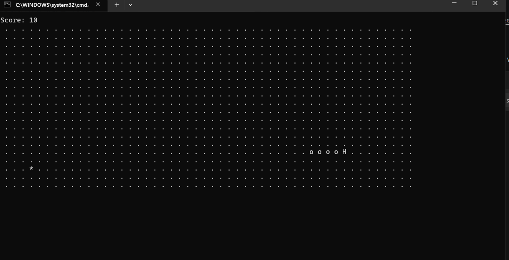

# 贪吃蛇（C++ 控制台版）

用 C++ 从零实现的经典贪吃蛇，跑在 Windows 控制台里。
这是我从零学习 C++ 项目开发的练手项目。

## 演示

## 怎么运行

需要：Windows + Visual Studio 2022（自带 MSVC 和 CMake）

（这里写你怎么编译：双击 build.cmd，或者命令行 cmake）

## 操作

| 按键 | 作用 |
|---|---|
| W / A / S / D | 上 / 左 / 下 / 右 |
| Q | 退出 |
注意必须是英文下的按键！！！

## 项目结构

将一大串main代码拆分成多个文件：
.hpp作函数声明
.c作函数具体实现

## 用到的技术

- C++20、CMake
- 多文件工程（声明与实现分离）
- 控制台 ANSI 转义序列（光标控制、无闪烁刷新）
- 固定时间步长的主循环